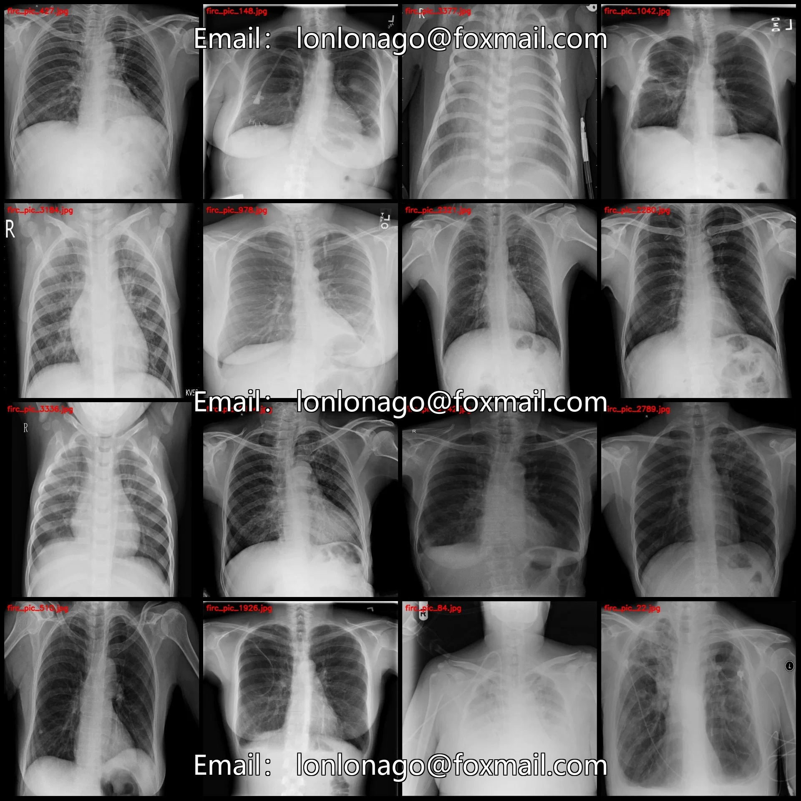
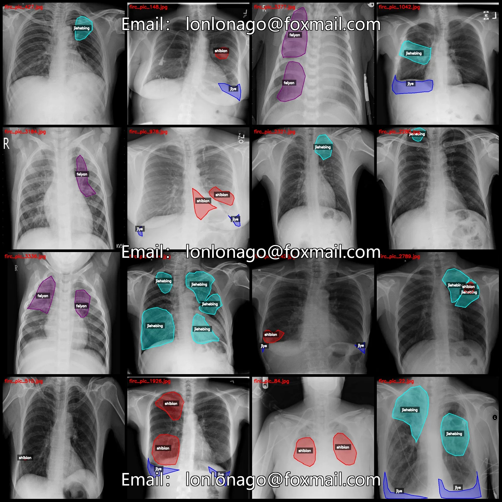
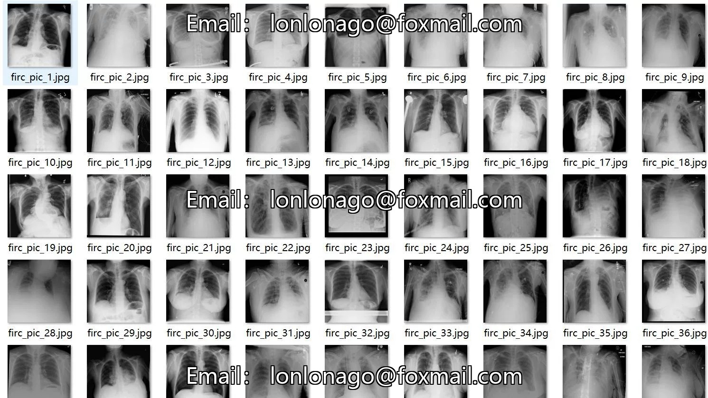
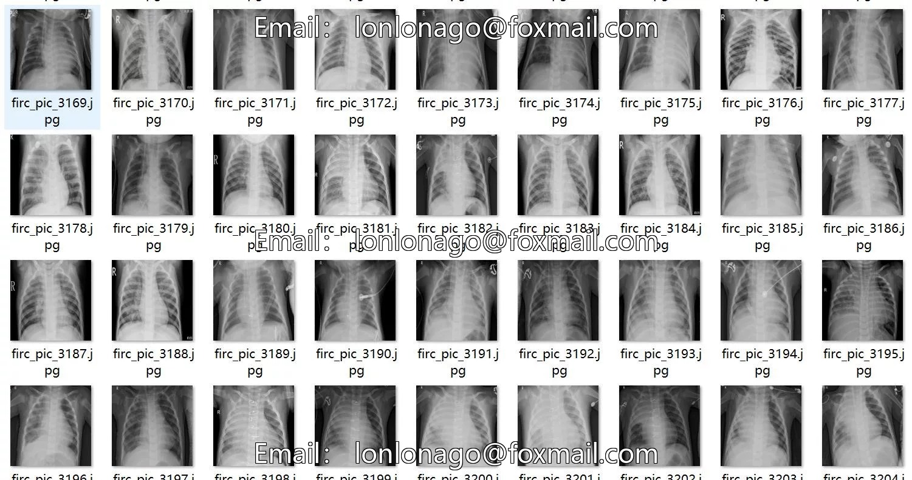
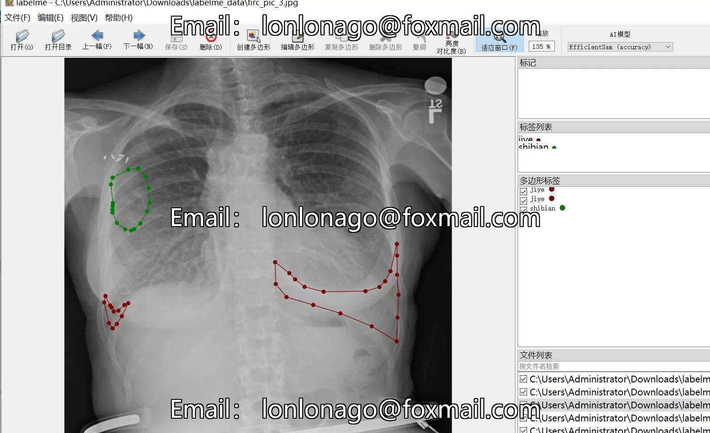
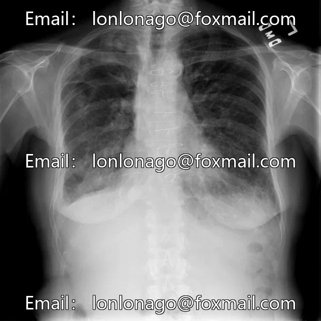
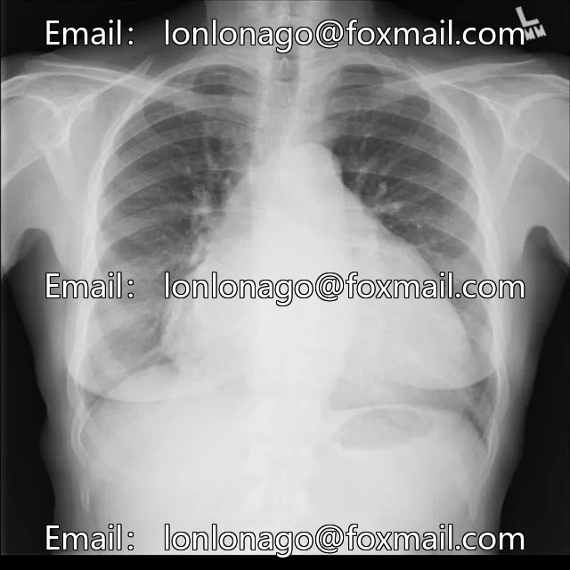
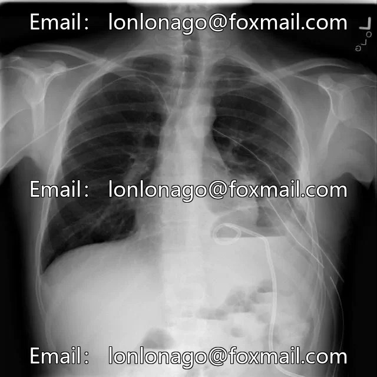

# Pneumonia and Tuberculosis Pleural Effusion Segmentation Dataset - LabelMe Format: 3751

## Body

Pneumonia and Tuberculosis Pleural Effusion Segmentation Dataset in LabelMe Format: 3751 Images, 4 Categories
Warm reminder: Due to the dataset's replicability, please confirm compliance before purchasing.
Dataset format: labelme format (without mask files, only including jpg images and corresponding json files)
Number of images (number of jpg files): 3751
Number of annotations (json file count): 3751
Labeling category count: 4
Label category names: ["feiyan", "jiehebing", "jiye", "shibian"]
For Chinese category: ["Pneumonia", "Tuberculosis", "Fluid", "Enlargement"]

Number of boxes and images occupied by each category
Feiyan: 1616 boxes, 925 images
Jiehebing: 2384 boxes, 1428 images
Jieye: 1510 boxes, 1176 images
Shibian: 2313 boxes, 1462 images
Total number of boxes: 7823
Labeling tool used: labelme=5.5.0
Image resolution: 640x640
Labeling rules: Polygons are drawn around the categories

Important Notice: The dataset can be opened and edited using LabelMe. For JSON datasets, you need to convert them into mask or Yolo formats for semantic segmentation or instance segmentation.
Special : This dataset does not guarantee the accuracy of the trained models or weight files.

## Images

## Payment

Here is a pay link on Stripe ( https://buy.stripe.com/3cs8yP7sY87d0vu9AB ). Please contact me lonlonago@foxmail.com after funding $89, and I will send you a complete data files , thank you!

